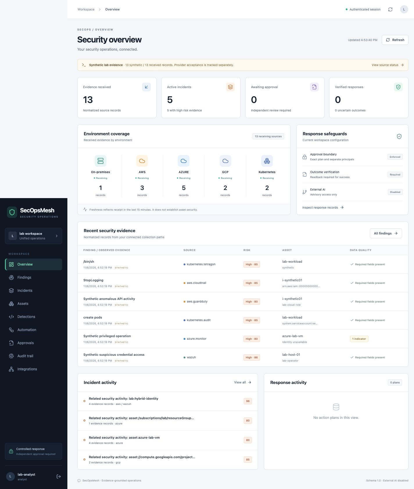

# SecOpsMesh

**Evidence-grounded hybrid security operations. Approval-bound response. Independently verified outcomes.**

SecOpsMesh unifies provider telemetry from on-premises Wazuh, AWS, Azure, GCP and Kubernetes. It normalizes evidence, runs versioned detections, correlates explicit asset/identity relationships, builds cited investigations, and executes tightly scoped response plans with three independent roles.



This is an executable engineering lab and production-oriented reference implementation. It is **not certified for production**. Live AWS/Azure/GCP/Wazuh acceptance requires your authorized environment. No live-provider results are claimed.

## Reproduce

On an existing Python 3.12+ and Node 24+ environment:

```sh
python -m venv .venv
.venv/bin/pip install -r requirements.lock
.venv/bin/pip install --no-deps -e .
npm ci --ignore-scripts --prefix frontend
npm run build --prefix frontend
.venv/bin/pytest --cov=secopsmesh
.venv/bin/python scripts/demo.py
```

The demonstration owns temporary API, executor and response-service processes, makes real loopback HTTP requests, tests application containment, and restores the target. The JSON result labels provider fixtures as synthetic. It uses no cloud account, API key or host firewall privilege.

To open the console, run `secopsmesh init-lab` once, then `secopsmesh lab`, `secopsmesh executor`, and `secopsmesh serve` in separate terminals, followed by `secopsmesh seed`. Open `http://127.0.0.1:8080`. Generated role credentials are in ignored `.runtime/tokens.json`; enter the appropriate operations credential. Use different analyst, approver and executor identities. Credentials stay in tab memory.

For the isolated PostgreSQL container deployment:

```sh
.venv/bin/python scripts/compose-config.py
docker compose up --build -d --wait
.venv/bin/secopsmesh seed --tokens .runtime/compose/tokens.json
.venv/bin/python scripts/container-acceptance.py
```

## What is implemented

- Thirteen bounded provider contracts across all five environment families, plus AWS EventBridge and GCP Pub/Sub envelopes. Read-only AWS SDK, Azure ARM/Sentinel, Event Hubs, GCP SCC/Pub/Sub and Wazuh Indexer bridges.
- Versioned canonical schema, persistent exact-delivery deduplication, upstream reference grouping, tenant-scoped asset/identity correlation, provenance, timestamps, quality/conflict flags and defensible ATT&CK mappings.
- Validated YAML detections, deterministic single-event and sliding-window rules, benign regression tests, replay reports and explicit evaluation bounds.
- Read-only MCP investigation tools and evidence-cited deterministic reports. Optional Claude advisory integration is disabled by default; no model can approve or execute.
- Immutable typed plans, deny-by-default policy, independent analyst/approver/executor principals, signed approvals, expiry, atomic execution claims, durable ambiguous-state recovery, separate readback and approved rollback.
- Separate response process with real reversible local **application traffic containment**. Optional narrowly scoped Cilium deny policy adapter and disposable Kubernetes packet-enforcement lab.
- Functioning React/TypeScript console for overview, sources, evidence, incidents, assets/timelines, detections/replay, plans, approvals, verification/rollback and audit integrity.

## Validation status

| Category | Evidence / status |
|---|---|
| Implemented and tested locally | Parser/API/security contracts; real HTTP application containment/readback/rollback; browser workflows; see [evidence](evidence/) |
| Verified against live provider | None of AWS, Azure, GCP or an external Wazuh deployment |
| Implemented, live verification pending | All provider bridges; optional Claude; optional deployment chart |
| Kubernetes kernel enforcement | Executable disposable kind/Cilium acceptance job; consult the actual [Actions run](https://github.com/jayekwere/secopsmesh/actions) and retained packet-probe report |
| Not implemented | General remote shell remediation, autonomous model response, destructive cloud changes, endpoint-agent replacement, enterprise SSO, HA operations certification |

CI runs lint/format/type checks, coverage-gated tests, dependency/SAST/secret scans, image/IaC scans, real HTTP demos, PostgreSQL tests, browser workflows, container acceptance and an independent Cilium lab. Third-party Actions use immutable commit references. Failure or absent acceptance evidence is not a pass.

Local release-candidate validation: **140 backend tests, 90.73% backend statement coverage, eight browser workflows**. The [validated release](https://github.com/jayekwere/secopsmesh/releases) attaches exact-commit CI measurements, provider-contract results, Docker/PostgreSQL and Kubernetes evidence, an SBOM, checksums and build-provenance attestations. Cloud contracts remain distinct from live cloud acceptance. See [validation scope and exclusions](docs/VALIDATION.md).

## Documentation

[Architecture](docs/ARCHITECTURE.md) · [Design decisions](docs/DESIGN-DECISIONS.md) · [Threat model](docs/THREAT-MODEL.md) · [Connector guide](docs/CONNECTORS.md) · [Deployment](docs/DEPLOYMENT.md) · [Security configuration](docs/SECURITY-CONFIGURATION.md) · [Detection authoring](docs/DETECTIONS.md) · [Automation](docs/AUTOMATION.md) · [API](docs/API.md) · [Demonstrations](docs/DEMOS.md) · [Security review and fixes](docs/SECURITY-REVIEW.md) · [Validation and limitations](docs/VALIDATION.md)

See [SECURITY.md](SECURITY.md), [CONTRIBUTING.md](CONTRIBUTING.md), [release notes](CHANGELOG.md), and the [Apache-2.0 license](LICENSE).
