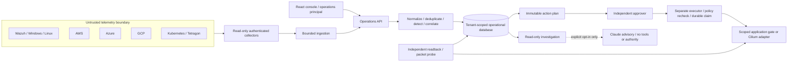

# Architecture and trust boundaries

SecOpsMesh uses one modular Python codebase, with separate process capabilities for the operations API, privileged executor and disposable response target. It deliberately uses the operational database instead of a separate message broker: transactions persist evidence/detections/incidents/audit together, and durable action rows carry execution intent and recovery state.

| Component | Owns | Cannot infer or grant |
|---|---|---|
| Collectors | Source-specific read credentials, checkpoints and API collector token | Tenant selection from events, approval or privileged target credentials |
| Ingestion / evidence engine | Bounded parsing, canonical schema, provenance, source revisions, exact-delivery IDs, logical upstream grouping | Provider authenticity from JSON shape; compromise certainty from a detection |
| Correlation / rules | Versioned deterministic rules, explicit trusted identity aliases, scoped timelines | Independent corroboration solely from a forwarded copy; security from absent alerts |
| Investigation | Read-only evidence tools, cited summaries, minimized optional AI packet | Privileged model tools, model approval or remediation execution |
| API / authorizer | Principal roles, exact plan generation, independent approval signature | A caller-selected target outside inventory or mutation without policy checks |
| Executor | Durable atomic claim, scoped response credential, apply/readback history | Arbitrary shell, arbitrary event URL, blind retry after ambiguity |
| Browser | Current user's in-memory credential and current-session evidence | Provider secrets, target response keys, evidence from a previous session after sign-out |
| Audit | HMAC chain and signed checkpoints | Tamper resistance against an administrator who also has signing authority |

Compose adds a minimal fixed reverse-proxy gateway: only that gateway joins the host-facing edge network. API, executor, database and lab remain on internal networks; only executor and lab share the response network. Host publication is loopback-only. The API has no target HMAC key, and no container mounts the operator's raw role-token file. Local same-user processes do not establish host-adversary isolation.

API and executor share database/signing authority, so the trusted authorizer remains a security root. This is a deliberate release limitation, not a claim of cryptographic independence from API compromise. The optional Helm configuration uses TLS between API and executor, read-only projected secrets, default-deny network policy and explicitly scoped database egress; it requires existing operator-managed secrets and infrastructure.

Canonical records distinguish source/observation time from receipt time, preserve redacted provenance, and expose quality/conflict/staleness indicators. API pagination, rule windows, batch/body bounds and history caps are explicit. PostgreSQL is the operational deployment target; SQLite supports independently reproducible account-free labs. No unmeasured production performance or HA guarantee is made.
