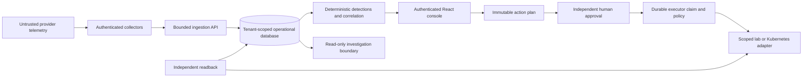

# SecOpsMesh threat model

Design baseline established before application implementation. This document is revised against the final source during release review.

## Overview

SecOpsMesh is a standalone security operations service. Authenticated collectors submit provider telemetry, a deterministic engine normalizes and correlates evidence, and analysts investigate incidents. A requester proposes a typed response; a different approver signs the immutable plan; an executor claims it durably and calls a constrained response adapter. A separate readback checks the outcome. External AI is optional, read-only, and disabled by default.

## Trust boundaries and assumptions

| Boundary | Asset / invariant | Enforcement planned |
|---|---|---|
| Internet or collector to ingestion | Availability, evidence provenance | Size/depth/count bounds, bearer identity scoped to tenant and source; signed webhook nonce and timestamp |
| Browser to API | Tenant confidentiality and human authority | Hash-only API credentials, role checks, no caller-chosen tenant, no browser credential persistence, same-origin UI |
| Evidence to detection | Finding and correlation integrity | Versioned validated schema, allowlisted predicates, operator-owned identity aliases; no executable rule expressions |
| Evidence to AI | Secrets and authorization | Minimal read-only evidence tools, schema/citation validation, no privileged tool, fixed provider URL, hard request/output budgets |
| Analyst to approval | Response authority | Exact plan digest including incident, tenant, target, action, expiry and policy version; independent principal |
| Approval to executor | Single execution and bounded privilege | Signed approval, atomic database transition, no arbitrary shell, conservative ambiguous-state recovery |
| Executor to target | Scope and effect | Separate credentials, fixed target inventory, typed actions, no cloud remediation enabled by default |
| Target to verification | Honest outcomes | Independent HTTP probe or policy readback plus disposable-lab packet test; failed verification is never success |
| Database to audit consumer | Audit integrity | HMAC hash chain, signed checkpoint export; external checkpoint retention is an operator obligation |

Operators control deployment configuration, credentials, rule files, the database and approved inventory. Host/root compromise is outside application isolation. TLS is mandatory beyond loopback; Compose's internal networks are a local lab boundary, not encryption. No live cloud accounts, production hosts or credentials are assumed. Linux/Windows telemetry arrives through Wazuh's supported agent/manager collection paths; SecOpsMesh is not an endpoint agent.

## Attacker stories and mitigations

| Priority | Hypothesis | Impact | Required controls / evidence to verify |
|---|---|---|---|
| High | Collector forges another tenant or spoofs a correlation identity | Confidentiality loss, misleading incident | Principal-derived tenant; explicit operator-owned aliases; tenant predicates on every lookup |
| High | Analyst approves their own containment or changes the plan after approval | Unauthorized containment | Separate identities, signed plan fingerprint, approval expiry and execution-time policy recheck |
| High | Concurrent/restarted worker repeats an ambiguous action | Unintended state change | Compare-and-swap state, idempotency key at target, durable attempt intent; reconcile by readback |
| High | Malicious evidence instructs AI to execute or disclose secrets | Privilege escalation or data exposure | No privileged tools or authority in model boundary; evidence allowlist and redaction; output treated as advice |
| High | Configured connector follows hostile pagination URL | Credential exfiltration / SSRF | Fixed HTTPS origin, relative path allowlist, redirects disabled, bounded streaming response |
| Medium | Replay or oversized event exhausts workers | Availability | Persistent replay key, rate limit, body/depth/list bounds, timeout and capped retry |
| Medium | A failed probe is recorded as containment | False assurance | Explicit unknown/failed states and separate verification records; packet enforcement distinct from policy existence |
| Medium | Audit rows are removed or changed | Concealed response | Hash chain and keyed checkpoint; external checkpoint detects truncation only when retained separately |
| Medium | Stale or contradictory provider data is presented as current truth | Misprioritization | Event and receipt timestamps, quality flags, observed scope, absence never proves security |

## Severity calibration

Critical: unauthenticated general code execution or cross-tenant privileged response. High: reachable tenant disclosure, approval bypass or unscoped response. Medium: bounded evidence integrity/availability failures requiring a collector identity. Low: diagnostics or local usability defects without authority gain. An operator deliberately granting broad credentials is a deployment risk, not proof of an application vulnerability. Test fixtures and API contract doubles cannot establish live provider acceptance or kernel network enforcement.

